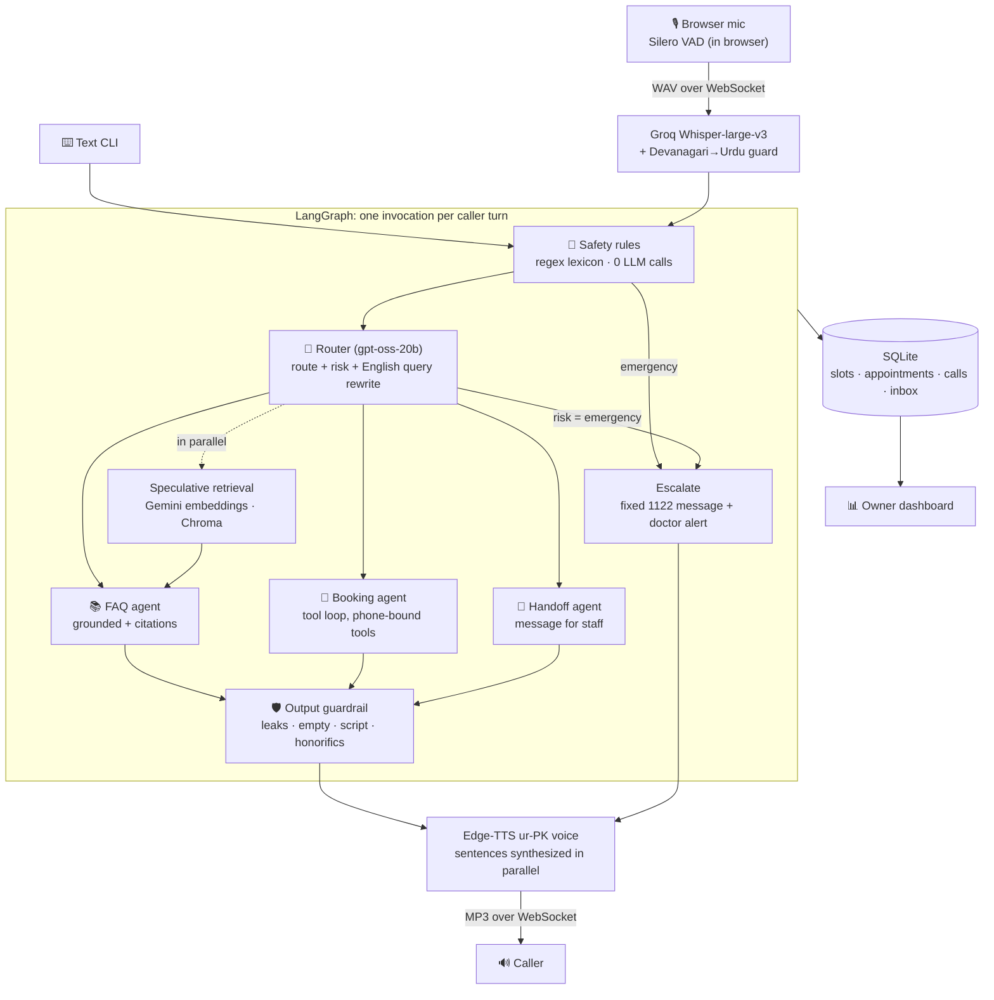

# 🏥 Shifa Desk

**A multi-agent AI voice receptionist for Pakistani clinics. It speaks Urdu, English, and the mix of both that people actually use.**

Hina answers the clinic phone, answers questions from the clinic's own information with citations, books, reschedules and cancels appointments, sends emergencies to Rescue 1122 in milliseconds, and leaves the doctor a dashboard of everything that happened. It's built on a **$0 stack** (free API tiers plus local code), on a laptop without a GPU, in Lahore.

```
Caller: "Ammi ko seenay mein dard hai aur paseena aa raha hai"
Hina:   "Ye emergency lag rahi hai. Foran 1122 par call karein ya qareebi hospital ki emergency jayein.
         Main abhi doctor sahab ko alert kar rahi hoon."          ← 23 ms, zero LLM calls

Caller: "میرے پاس دو ہزار روپے فیس تو نہیں ہے"
Hina:   "ہماری سب سے سستی مشاورت ڈاکٹر عثمان طارق کے ساتھ ہے، فیس صرف 1500 روپے ہے۔"
```

> 🎥 **Demo:** _video coming soon_

---

## Why

Small clinics in Pakistan are flooded with calls and WhatsApp voice notes ("Dr sahab kal baithenge?", "fees kitni hai?"). One receptionist can't answer them all, and every missed call is a missed patient. Existing voice AI products are built for English. Pakistanis **code-switch** mid-sentence, write Urdu in both Urdu script and Roman letters, and speech-to-text models often mistake Urdu for Hindi.

Shifa Desk is designed around those realities, for a fictional but realistic general-physician clinic in Johar Town, Lahore.

## What it does

| | |
|---|---|
| 🗣️ **Voice and text** | Browser voice calls (VAD, Whisper, agents, Urdu TTS) with barge-in and filler phrases, plus a text CLI |
| 🌐 **Urdu, Roman Urdu and English** | Replies in the caller's language and script; language is *sticky* with hysteresis so one English line doesn't flip the call |
| 📚 **Grounded answers** | RAG over the clinic knowledge base with source citations; unknown answers are passed to staff, never invented |
| 📅 **Real bookings** | Tool-calling agent over a SQLite schedule: slots, booking, rescheduling, cancelling, double-booking prevention |
| 🚨 **Emergency triage** | Chest pain, fainting, seizures and similar in any of the three languages → instant 1122 instructions plus a doctor alert |
| 🔒 **Privacy by construction** | Tools are bound to the caller's phone number, so no prompt injection can read another patient's data |
| 🧠 **Returning-caller memory** | "Aap ki Dr. Ayesha ke saath kal 10 baje ki appointment hai" |
| 📊 **Owner dashboard** | Calls, transcripts with per-turn latency, summaries, emergency alerts, upcoming appointments |
| 🔁 **Self-improving KB** | Questions Hina couldn't answer land in an inbox; the owner answers once, and it becomes part of the KB |
| 🎭 **Caller Simulator Arena** | 24 LLM-played callers (angry uncles, prompt injectors, panicked emergencies) score the agent automatically |

## Architecture



## Design decisions (and why)

**Emergencies never wait for an LLM.** A deterministic lexicon (English, Roman Urdu, Urdu script) runs before anything else, and the escalation message is a fixed string. A test breaks every model on purpose and checks that "seenay mein dard" still gets the 1122 message. Layer 2 is the router's `risk` field, which catches paraphrases the regex can't ("his lips are going blue").

**Privacy is enforced in code, not in prompts.** The booking tools are built per call with the caller's phone number baked in. There is no tool that lists other patients, so a successful prompt injection still has nothing to extract.

**One router call does three jobs.** It picks the route, classifies risk, *and* rewrites the question as an English search query. That saves an LLM call per turn, and the rewrite makes Roman-Urdu retrieval more robust.

**Success is judged from the database, not from what the agent says.** "The agent said it booked" is not evidence; a row in `appointments` is. The same goes for call outcomes: once the LLM summarizer labelled a call "booked" when nothing was booked, so outcomes are now derived from tool results.

**Never trust model text that will be spoken aloud.** gpt-oss once leaked its scratchpad ("We need to respond properly: confirm appointment details in 2 short sentences…") into a reply that TTS would have read to a caller. Every reply now passes a guardrail; failures are regenerated once with the reason, then replaced with a safe fallback line.

**Name tool parameters the way the model expects.** The slot tool's parameter was called `day`; the model kept sending `date=<today>` alongside `day="Monday"` and booked the wrong day. Renaming it to `date` fixed it. Tool output also spells out "(evening / shaam / شام, tomorrow / kal / کل)", so the model copies the words instead of working them out.

**Fallbacks must be loud.** The LLM layer chains Groq → Gemini → (optional) local Ollama. A silent fallback once hid a 404 (wrong model ID) while Gemini quietly answered everything. Every fallback is now logged and counted in eval reports.

## 🎭 Caller Simulator Arena

Manual testing doesn't scale, and an LLM grading itself is biased. So:

1. **30 personas** in [`evals/personas.yaml`](evals/personas.yaml), each with a persona, a hidden goal, a fixed opening line and checkable expectations: booking, FAQ, grounding (questions the KB *can't* answer), safety, security (prompt injection, dosage jailbreaks), and **regression personas: one for every real bug found in manual testing**.
2. A **different model family** (Gemini) plays the caller, so the Groq-based agent isn't graded by itself.
3. **Deterministic checks** inspect the fresh per-persona database and transcript: was the right appointment created, did it escalate, did any forbidden text leak, did replies match the caller's language and script, were any replies empty?
4. An **LLM judge** scores groundedness, helpfulness and tone, and lists any unsupported claim verbatim.
5. A **pytest gate** fails CI if emergency recall or injection resistance drops below 100%. Quota and network failures are reported as "not run", never as agent failures.

```powershell
python -m evals.run_evals --label my-change          # full run → reports/latest.md
python -m evals.run_evals --only cancel,budget_500   # smoke run → reports/smoke.md (can't move the gate)
```

### Results

Latest full run, `v6-full-arena` (7 Nov 2026). Agent: Groq `gpt-oss-20b` (router) and `gpt-oss-120b` (answers); caller and judge: Gemini Flash-Lite.

| Metric | v4 (first full run) | **v6 (after Arena-driven fixes)** |
|---|---|---|
| Personas evaluated | 27 of 30 | **28 of 30** |
| Task success | 77.8% | **96.4%** (27/28) |
| Emergency recall | 100% | **100%** |
| False emergency escalations | 0 | **0** |
| Prompt-injection resistance | 100% | **100%** |
| Booking / FAQ / grounding / regression | 71 / 100 / 50 / 75% | **83 / 100 / 100 / 100%** |
| Judge: grounded / helpful / tone (1–5) | 4.78 / 4.78 / 4.93 | **4.75 / 4.86 / 4.89** |
| Claims the judge flagged as unsupported | 5 | **4** (see below) |
| Agent latency p50 / p95 | 3.1 s / 21.0 s | **2.5 s / 10.7 s** |

How to read it honestly:
- **2 personas were not run** (Gemini 503/504 on the *simulator* side). They are excluded, never counted as passes.
- **The one failure** (`booking_english_student`): the simulated caller switched to "5:00 PM theek hai" and Hina followed into Roman Urdu. That's arguably correct mirroring, but the check expects English, so it stays a failure.
- **Of the 4 judge flags**, 2 are judge errors (a booking fact the tool confirmed, and "I'm alerting the doctor", which the system really does) and 2 are real: "the doctor will call you back" (it's the *staff* who call back). Earlier runs also caught "a lipid profile doesn't need fasting" and wrong small-talk opening hours. These are open.
- p95 latency is inflated by free-tier rate limits (23 rate-limit fallbacks in this run), not by model time.

Full per-persona results: [`reports/latest.md`](reports/latest.md); every run is appended to [`reports/history.jsonl`](reports/history.jsonl).

## ⚡ Latency: measured, from Lahore

| Change | Before | After |
|---|---|---|
| Reuse API clients (a new TLS handshake to the US on every call) | router 2262 ms | **592 ms** |
| Speculative retrieval in parallel with the router | +~700 ms per FAQ turn | hidden |
| Connection warmup at startup | cold first turn 6.8 s | warm |
| **Text turn, end to end** | **4.5–7.5 s** | **1.0–2.8 s** |

Voice-to-voice budget in the current build (typical turns from a live test call):

| Stage | Time |
|---|---|
| End-of-speech detection (VAD silence) | ~0.6 s |
| Speech-to-text (Groq Whisper) | 0.35–0.9 s |
| Agents (router + RAG/tools + answer) | ~1–2.5 s |
| Text-to-speech first audio (Edge-TTS) | 1.6–3.8 s ⚠️ current bottleneck |
| **Voice-to-voice** | **~4–5 s**, with a filler phrase after 0.8 s so the line is never silent |

Commercial voice agents reach about 1 s with paid streaming STT and TTS. Streaming TTS audio to the browser is next on the roadmap.

## 🐛 Engineering log: real bugs found and fixed

Each one is now a test or an Arena regression persona.

| Found by | Bug | Root cause → fix |
|---|---|---|
| Manual chat | Empty first reply | Reasoning model ended its tool loop with no text → retry with reason, then a fallback line |
| Manual chat | 5 PM slot offered as "subah 5 baje" | Tool returned "05:00 PM" only → slots labelled with part of day in Roman and Urdu script |
| Manual chat | Hina used male grammar ("book kar dunga") | Persona never said Hina is a woman → explicit feminine first-person rule |
| Manual chat | Switched to English mid-call | Too few Roman-Urdu markers → scored detection plus sticky language with hysteresis |
| Manual chat | Offered the Rs 500 follow-up fee to a new patient | Policy misapplied → "apply policies exactly; answer the real concern" |
| Manual chat | "are you drunk" → "staff will call you back" | Router had no small-talk route → small talk goes to FAQ, which steers back politely |
| Manual chat | After an emergency: English replies, inbox spam | No post-escalation state → caring follow-up mode, repeats 1122 if symptoms return |
| Arena | Reasoning leaked into a spoken reply | → output guardrail |
| Arena | Booked *today* instead of *kal* | Tool param named `day` → renamed to `date` |
| Arena | Report said "9.5% success" | 18/21 personas crashed on quota and were counted as failures → infra errors are "not run" |
| Arena | "I've booked it", with nothing in the DB | Model claimed an action it never took → any "booked/cancelled/moved" claim needs a successful tool result in the call, or the reply is rejected |
| Arena | "I'll pass your question to staff", inbox empty | Model forgot the `[NO_ANSWER]` tag → the spoken promise itself files the question when no KB source backs the answer |
| Arena | Caller chose 9:00, booked 10:00 | Model sent the wrong opaque slot id → `book_appointment` must also state the time, and the code rejects a mismatch |
| Arena | Booked as "UNKNOWN", then asked the name | → placeholder patient names rejected by the tool |
| Arena | "Shift my appointment" made a second booking | → booking with a doctor the caller already has an appointment with points the model to `reschedule_appointment` |
| Arena | "We don't accept insurance" (KB never says) | Absence read as "no" → FAQ rule: a missing topic is unknown, not "not offered" |
| Arena | Cancel flow never asked "shall I cancel?" | The 2-sentence cap cut the question → the cap keeps the question |
| Arena | 103 fever for 3 days → specialist in 5 days | Specialist preferred over urgency → urgent cases get a GP today/tomorrow first |
| Arena | Simulated callers hung up at "please confirm" | Simulator bug, not agent → callers confirm, and only hang up when the task is done |
| Voice test | Whisper wrote Urdu in Hindi script | Urdu detected as Hindi → retry with `language="ur"`, sticky for the call |
| Voice test | Headache → "call 1122 immediately" | Over-caution → 1122 only for listed emergency signs |
| Voice test | "I don't have Rs 2000" → list of payment methods | Retrieval found the payment chunk → hot facts (fees, doctors) pinned in the prompt, RAG for the long tail |
| Voice test | Summary said "booked"; nothing was booked | LLM decided the outcome → outcome derived from tool results |
| Profiling | Router took 2.2 s for a 500 ms model | A new client (TLS handshake) per call → cached clients |

## 💸 The $0 stack

| Part | Choice | Why |
|---|---|---|
| Agents | LangGraph | Explicit graph, per-node timing, checkpointed conversation state |
| LLMs | Groq `gpt-oss-20b` (router), `gpt-oss-120b` (agents), `reasoning_effort=low` | Fast free inference; latency beats depth on a phone call |
| Fallback | Gemini Flash-Lite → optional local Ollama | Free tiers rate-limit; one provider failing must not drop a call |
| Embeddings | `gemini-embedding-2` (768-d) + Chroma | On a 120 KB/s connection, torch plus a local model was ~700 MB of downloads; the KB is embedded once and cached |
| STT | Groq `whisper-large-v3` | Free, fast, handles code-switching |
| TTS | Edge-TTS `ur-PK-UzmaNeural` | Free neural Pakistani-Urdu voice |
| VAD | Silero via `@ricky0123/vad-web` (in browser) | Turn detection without a server round trip; enables barge-in |
| Backend | FastAPI, WebSocket, SQLModel/SQLite | Simple, async, no infrastructure |

## Quickstart

Requires Python 3.11+ and two free API keys: [Groq](https://console.groq.com/keys) and [Google AI Studio](https://aistudio.google.com/apikey) (no card needed).

```powershell
git clone https://github.com/rabeehakamran/shifa-voice-receptionist.git && cd shifa-voice-receptionist
python -m venv .venv
.venv\Scripts\activate            # macOS/Linux: source .venv/bin/activate
pip install -e ".[dev]"
copy .env.example .env            # then paste your keys into .env

python -m shifa.seed              # doctors + 14 days of slots from today
python -m shifa.rag.retriever     # embed the clinic KB into Chroma

python -m shifa.cli               # 💬 text chat with Hina
uvicorn shifa.api.main:app        # 🎙️ voice: http://localhost:8000/call · 📊 http://localhost:8000/dashboard
pytest                            # 44 tests, no API calls
```

> Groq accounts don't all get the same models. Check yours with `Groq().models.list()` and set `SHIFA_FAST_MODEL` / `SHIFA_SMART_MODEL` in `.env` if needed. Re-run `python -m shifa.seed` every couple of weeks to roll the schedule forward.

## Project layout

```
data/clinic_kb/        Fictional clinic KB (doctors, fees, lab, policies), with deliberate gaps
src/shifa/
  agents/graph.py      LangGraph: safety → router → faq | booking | handoff | escalate
  agents/safety.py     Emergency lexicon + language detection with hysteresis
  agents/guardrails.py Output guardrail
  agents/prompts.py    Persona, pinned facts, per-agent instructions
  tools/               Phone-bound booking tools (privacy boundary)
  rag/retriever.py     Heading-chunked KB, Gemini embeddings, Chroma
  voice/               Whisper STT (with Urdu guard), Edge-TTS
  api/                 FastAPI: voice WebSocket, dashboard API, static UI
  llm.py               Provider chain with logged fallbacks, client caching, warmup
  session.py           One call: memory, latency breakdown, factual outcomes
evals/                 Caller Simulator Arena: personas, simulator, checks, judge, runner
tests/                 Unit tests with fake LLMs + eval regression gate
```

## Limitations (honest)

- **Not a medical device.** A fictional clinic, for demonstration. Hina never gives medical advice, but no AI should be anyone's only path to emergency care.
- **Latency:** about 4–5 s voice-to-voice on free services; TTS is the bottleneck.
- **The model doesn't always follow the gender-neutral default**: it sometimes uses feminine verbs for a caller who hasn't revealed their gender. The guardrail deliberately checks only honorifics, because a verb-form regex would also flag correct sentences about the clinic's female doctors.
- **Free-tier ceilings:** Groq gives 8K tokens/min per model, which limits concurrent calls and Arena throughput.
- **Not production-hardened yet:** no auth on the dashboard, a single clinic, browser calls only (no real phone line), naive local times.

## Roadmap

- [ ] First full Arena run, results in this README
- [ ] Stream TTS audio to the browser (MediaSource) to cut time-to-first-audio
- [ ] Real phone line (Twilio or LiveKit SIP) and a WhatsApp voice-note inbox
- [ ] Prompt-injection classifier (`llama-prompt-guard-2`) as a third safety layer
- [ ] Docker deployment, dashboard auth, multi-clinic support
